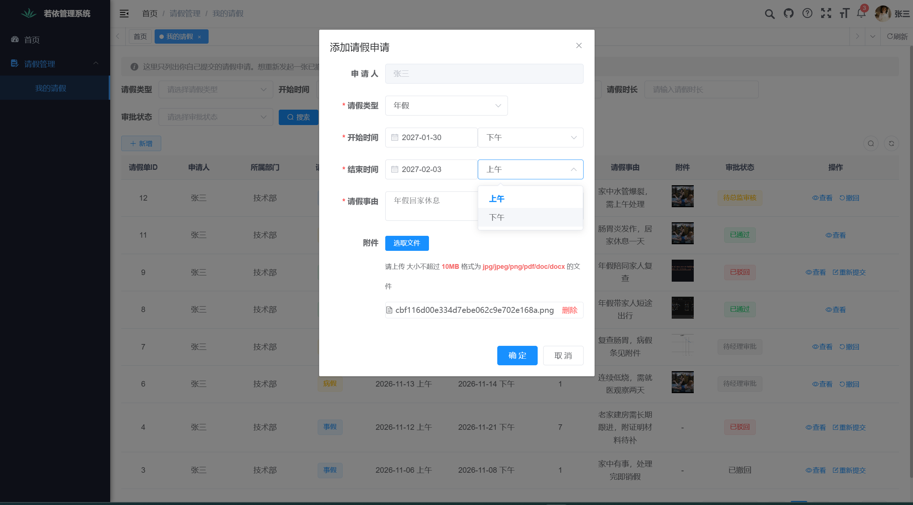
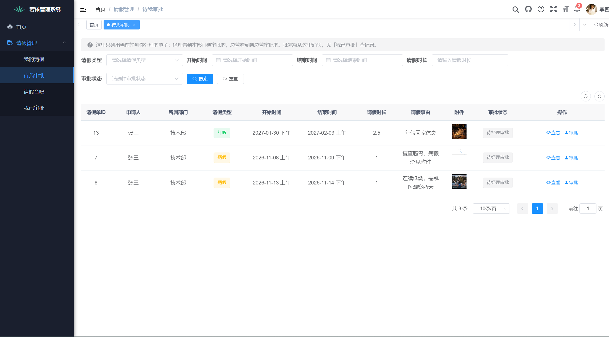
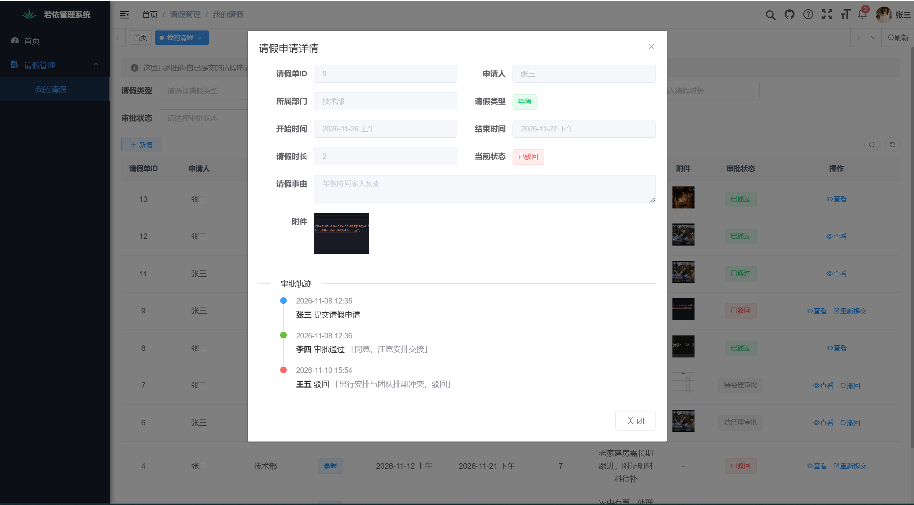
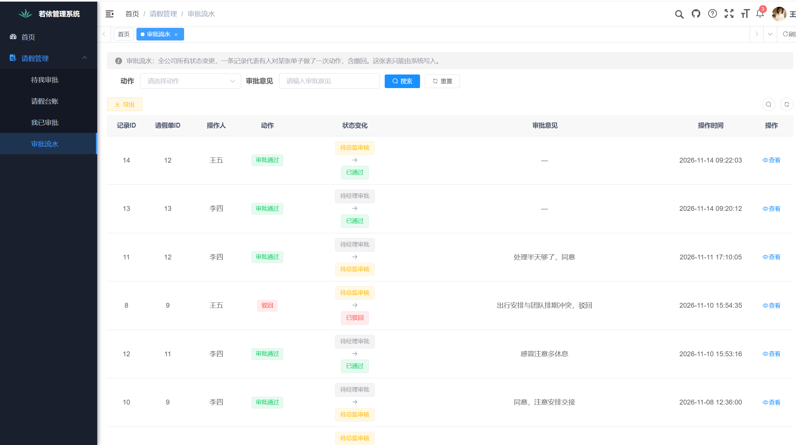
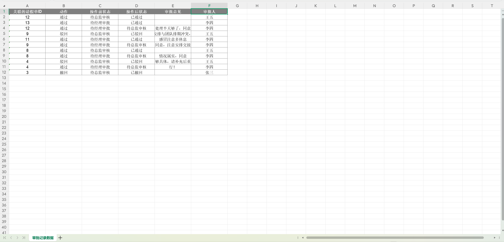

# 员工请假审批系统

基于开源框架 [RuoYi-Vue](https://gitee.com/y_project/RuoYi-Vue) （Spring Boot + Vue2 + MySQL + Redis）二次开发的员工请假审批系统，实现请假申请、请假审批、审批留痕与台账查询的完整闭环。

## 特性

- **三级角色两条审批线**：员工提交 → 经理一级审批 → 超过 3 天的假期自动升级到总监二级审批
- **半天颗粒度**：请假按上午/下午申请，时长按工作日自动计算（周末不计入），同一时间段重复提交会被拦截
- **数据权限分级**：员工只看自己的单，经理看本部门，总监看全公司
- **审计可追溯**：每次审批/驳回/撤回都写入只增不删的流水表，请假单据不提供物理删除

## 演示账号

| 账号 | 密码      | 角色 | 可演示内容 |
|---|---------|---|---|
| zhangsan | 123456  | 普通员工 | 提交/撤回请假、查看自己的单据与时间线 |
| lisi | 123456  | 部门经理 | 一级审批、本部门请假台账 |
| wangwu | 123456+ | 总监 | 二级审批、全公司台账与审批流水 |

> 超级管理员 admin 按设计**不参与业务动作**（不可申请/审批），仅用于系统配置演示，原因见「设计要点」第 4 条。

## 快速开始

### 环境要求

| 依赖 | 版本要求 |
|---|---|
| JDK | 17 |
| MySQL | 8.x |
| Redis | 5.x+ |
| Node.js | ≥ 18 |
| Maven | 3.6+ |

### 1. 初始化数据库

```sql
CREATE DATABASE `ry-vue` DEFAULT CHARACTER SET utf8mb4;
```

依次执行三个脚本（**必须带 `--default-character-set=utf8mb4`**，否则中文种子数据会报 Data too long）：

```bash
mysql -uroot -p --default-character-set=utf8mb4 ry-vue < sql/ry_20260417.sql
mysql -uroot -p --default-character-set=utf8mb4 ry-vue < sql/quartz.sql
mysql -uroot -p --default-character-set=utf8mb4 ry-vue < sql/leave_install.sql
```

`leave_install.sql` 为幂等脚本，重复执行不会产生重复数据。

### 2. 启动后端

1. 启动 Redis（默认端口 6379）
2. 修改 `ruoyi-admin/src/main/resources/application-druid.yml` 中的数据库账号密码
3. 运行 `com.ruoyi.RuoYiApplication`（默认端口 8080）

> 注意：仓库内的数据库密码、Druid 监控台账号、JWT 密钥均为开发/若依官方默认值，仅供本地演示，部署到公网前必须全部更换。

附件上传功能依赖阿里云 OSS，通过环境变量 `OSS_ACCESS_KEY_ID` / `OSS_ACCESS_KEY_SECRET` 注入，不配置不影响主流程（演示数据中的附件链接在他人环境不可下载）。

### 3. 启动前端

```bash
cd ruoyi-ui
npm install
npm run dev
```

浏览器访问前端地址，使用上表演示账号登录。

### 4. 体验推荐路径

用 zhangsan 提交一张 3 天以上的请假（附件可跳过）→ 用 lisi「待我审批」通过一级 → 用 wangwu 通过二级 → 回到 zhangsan「我的请假」点开详情查看完整审批时间线。

## 功能速览

**按半天颗粒度提交申请**——申请人锁定为本人，附件随单上传。示例中开始日为周六，系统自动跳过周末，算出 2.5 天：



**经理的待办视野**——只列本轮该他处理的单；侧边栏没有「审批流水」入口，本部门之外的历史不可见（数据范围驱动）：



**单据详情的审批时间线**——提交 → 经理通过 → 总监驳回，每一步带操作人和意见，数据来自只增不删的流水表：



**总监视角的全公司流水**——状态变化、审批意见一览无余；页面顶部的提示不是装饰：这张表只能由系统写入：



**导出即成品**——流水导出的 Excel，列名、动作、状态全部中文直出，无需二次加工：



## 设计要点

### 1. 请假时长按「半天份数累加」，不做日期相减

日期轴上直接相减，需要对「首日/末日只请半天」「区间内剔除周末」分别做边界修正，Fri PM → Mon AM 这类跨周末场景极易差 0.5 天。改为逐日累加「半天份数」（每个工作日 +2，首日 PM 起 +1、末日 AM 止 −1 的等价写法），除以 2 得天数：剔除周末只是一个 continue，「同一天下午开始上午结束」的 0 天假自然归零，可被一条校验拦截。

### 2. 重叠校验用 MySQL 行构造器，不用 BETWEEN

请假冲突的本质是区间相交：`A开始 ≤ B结束 且 A结束 ≥ B开始`。当「日」还需要和「上午/下午」组合比较时，BETWEEN 会漏掉一段完整包含另一段的形状。将两列捆成行构造器按字典序比较：

```sql
(start_time, start_half) <= (#{endTime}, #{endHalf})
  AND (end_time, end_half) >= (#{startTime}, #{startHalf})
```

一个 WHERE 同时覆盖部分重叠、完全包含、端点相接全部形态。

### 3. 审批流水只增不删——单据也因此不给删除接口

`approval_record` 记录「谁在何时把单据从什么状态改到什么状态」，它自身没有任何删除/修改入口（只增不删）。但流水仍有一条被毁灭的路径：删除它挂靠的单据——`leave_id` 指向不存在的单据，流水就成了查无对证的幽灵记录，审计链断裂。所以保护流水的第二环是不给单据开删除接口：作废用 `CANCELLED` 状态表达，行永远留在库里。

### 4. 超级管理员「能审计、不能下手」

若依的 `hasRole`/`hasPermi` 对 admin 恒为 true，任何「禁止某角色审批」的反向校验都拦不住它。因此本系统让 admin 从不进入审批链：业务接口以角色校验正向把关，admin 仅保留查看能力。这个设计同时也是对「权限体系存在恒真出口」这一通用风险的规避。

### 5. 可推导的数据不落字段，实时计算

「待我审批」「我已审批」等视图全部由 `leave_request.status` + 角色数据范围实时查询得出，不维护任何冗余计数。冗余字段意味着每一处写操作都要同步维护它，漏一处就永久不一致——单一数据源。

### 6. 详情查看权按「流水里有我」判定，不按角色猜测

审批人批完单后单据状态继续流转，若按「角色 + 当前状态」推断查看权，审批人会失去对自己刚批过的单的可见性。改为查询流水：`approval_record` 中存在「此单 + 此人」即视为经手过、放行。历史事实不随单据状态变化，判定永远稳定。

## License

本项目基于 MIT license 开源，沿用 RuoYi-Vue 的许可证。
